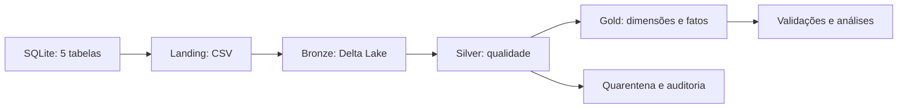

# Lakehouse com Databricks e arquitetura Medalhão


📘 **Documentação (disponível após publicação):** https://02kamk.github.io/lakehouse-databricks-medalhao/

👥 **Integrantes:** Kamily Hilário das Luzes · Kauã Lucas Alves Barbosa

---

## Sumário

- [Descrição](#descrição)
- [Avisos](#avisos)
- [Pré-requisitos](#pré-requisitos)
- [Instalação](#instalação)
- [Howto - como executar](#howto)
- [Testes](#testes)
- [Documentação](#documentação)
- [Referências](#referências)

---

## Descrição

Trabalho 3 da disciplina de **Engenharia de Dados (SATC)**, continuação do
[Trabalho 1](https://github.com/02kamk/apachespark) e do
[Trabalho 2](https://github.com/02kamk/spark-minio-delta-lake).

O projeto implementa um **Lakehouse no Databricks Free Edition**, com a arquitetura
**Medalhão**: extrai todas as tabelas de um banco relacional para **CSV na Landing**,
grava tabelas **Delta Lake na Bronze**, aplica **Data Quality na Silver** e constrói
um **modelo dimensional na Gold**. Um **Job sequencial** encadeia os notebooks e a validação final.

O cenário continua sendo uma **academia**, com as cinco tabelas e o gerador de dados
do trabalho 2. A origem deste trabalho é **SQLite**, conforme a escolha livre de banco
prevista no enunciado. SQL Server e MinIO fazem parte do trabalho anterior.



O **Ubuntu no WSL2** prepara o banco e a documentação. O **Databricks** executa o Spark
na nuvem, em compute **Serverless**. Este README explica como instalar, executar e testar;
a documentação MkDocs explica a arquitetura, as regras e a modelagem.

---

## Avisos

> [!IMPORTANT]
> **Repositório separado.** O trabalho 3 deve ter um novo repositório.
> Nome utilizado nesta configuração: `lakehouse-databricks-medalhao`.

> [!NOTE]
> **Não é necessário instalar Spark ou Databricks no Ubuntu.** O Databricks é acessado
> pelo navegador. Java, Docker, MinIO e ODBC não são dependências deste trabalho.

> [!WARNING]
> **Carga completa:** os notebooks substituem as tabelas de mesmo nome em `bronze`,
> `silver` e `gold` no catálogo informado. Use um ambiente acadêmico dedicado, um Job
> por vez e um snapshot estável durante a execução.

> [!IMPORTANT]
> **Banco e manifesto precisam corresponder.** Se reconstruir `academia.db`, envie
> novamente o banco e `origem_manifest.json` para o volume de origem.

> [!NOTE]
> Os dados são fictícios. A Free Edition exige internet e possui cotas de compute.
> O modelo usa dimensões tipo 1 e chaves técnicas derivadas dos IDs da origem única.
> Não há histórico contratual nem carga incremental neste laboratório.

---

## Pré-requisitos

### Ambiente

| Componente | Configuração | Finalidade |
|---|---|---|
| Ubuntu | 24.04 LTS no WSL2 ou Linux equivalente | preparação local |
| Python | 3.10 ou superior | scripts, banco e documentação |
| Git | versão recente | versionamento e publicação |
| Databricks | Free Edition, compute Serverless | notebooks e Job |
| Unity Catalog | catálogo com permissões de criação, leitura e escrita | schemas, volumes e tabelas |

### Bibliotecas e ferramentas

| Componente | Versão | Observação |
|---|---|---|
| `sqlite3` do Python | biblioteca padrão | cria e consulta a origem |
| `mkdocs` | 1.6.1 | gera a documentação |
| `mkdocs-material` | 9.7.7 | tema do site |
| Spark e Delta Lake | fornecidos pelo Databricks | não instalar via pip no workspace |

As dependências diretas da documentação estão em [`requirements-docs.txt`](requirements-docs.txt).
A pasta `.venv/` não entra no Git.

---

## Instalação

Todos os comandos são executados no **terminal do Ubuntu**.

### 1. Instalar utilitários

```bash
sudo apt update
sudo apt install -y python3 python3-venv python3-pip git sqlite3
python3 --version
git --version
sqlite3 --version
```

### 2. Entrar no projeto

Para uma cópia já existente:

```bash
cd ~/projetos/lakehouse-academia
```

Depois da publicação, uma máquina nova pode clonar o repositório:

```bash
mkdir -p ~/projetos
cd ~/projetos
git clone https://github.com/02kamk/lakehouse-databricks-medalhao.git lakehouse-academia
cd lakehouse-academia
```

### 3. Criar o ambiente virtual

```bash
python3 -m venv .venv
source .venv/bin/activate
python -m pip install -r requirements-docs.txt
```

### 4. Preparar a origem, na primeira montagem ou reconstrução

```bash
python scripts/gerar_dados.py
python scripts/preparar_origem.py
python scripts/testar_local.py
```

São criados os CSVs, `data/academia.db` e o manifesto com hash e contagens.
Se o banco já foi enviado ao Databricks e o Job passou, **não precisa reconstruir a origem
para executar ou publicar o MkDocs**.

### 5. Configurar o Databricks

1. Entre na sua conta Free Edition.
2. Importe `notebooks/*.py` como notebooks Python no formato SOURCE.
3. Abra `00_configurar`, informe o catálogo permitido no parâmetro `catalogo` e execute tudo.
4. O padrão é `workspace`; use o mesmo valor em todos os notebooks e tarefas.
5. Envie `academia.db` e `origem_manifest.json` para o volume:

```text
/Volumes/workspace/origem/arquivos/
```

Se usar outro catálogo, ajuste o caminho. O notebook `00` cria os schemas e volumes;
ele fica fora do Job.

---

<a id="howto"></a>
## Howto - como executar

### Ordem dos notebooks

| Notebook | Etapa | Resultado |
|---|---|---|
| `00_configurar` | preparação inicial | schemas e volumes |
| `01_extrair_landing` | extrair todas as tabelas SQLite | cinco CSVs e manifesto |
| `02_landing_bronze` | CSV para Delta | cinco tabelas Bronze e `_ingestao` |
| `03_bronze_silver` | qualidade | Silver, quarentenas e auditoria |
| `04_silver_gold` | modelo dimensional | quatro dimensões e duas fatos |
| `05_validar` | testes e análises | reconciliações, receita e visitas |

### Job sequencial

Em **Jobs & Pipelines**, crie o Job `academia-medalhao`:

| Tarefa | Notebook | Depends on |
|---|---|---|
| `extrair` | `01_extrair_landing` | nenhuma |
| `bronze` | `02_landing_bronze` | `extrair` |
| `silver` | `03_bronze_silver` | `bronze` |
| `gold` | `04_silver_gold` | `silver` |
| `validar` | `05_validar` | `gold` |

Em todas as tarefas: **Serverless**, **`catalogo=workspace`** e **Run if: All succeeded**.
Ajuste o catálogo se necessário. Configure uma execução simultânea do Job.
Clique em **Run now** e confira as cinco tarefas em **Succeeded**.

[`jobs/job.template.json`](jobs/job.template.json) é uma referência estrutural;
substitua os caminhos com `SEU_EMAIL` antes de utilizá-lo em uma API.

### Acompanhar os dados

| Camada | Local no Catalog Explorer |
|---|---|
| Origem | `workspace.origem.arquivos` (volume) |
| Landing | `workspace.landing.dados` (volume CSV) |
| Bronze | `workspace.bronze` |
| Silver | `workspace.silver`, incluindo quarentenas e auditoria |
| Gold | `workspace.gold` |

### Estrutura do projeto

```text
lakehouse-academia/
├── .github/workflows/docs.yml   # verificações no GitHub Actions
├── data/                       # CSVs e manifesto; banco gerado localmente
├── docs/                       # páginas do MkDocs
├── evidencias/                 # registros de validação
├── jobs/job.template.json      # referência do Job
├── notebooks/                  # configuração e pipeline Databricks
├── scripts/                    # gerador, banco e testes
├── .gitignore
├── mkdocs.yml
├── requirements-docs.txt
└── README.md
```

---

## Testes

### 1. Verificação local sem reconstruir o banco

```bash
source .venv/bin/activate
python scripts/testar_local.py
```

Confere integridade referencial, hash do snapshot, contagens CSV/banco e sintaxe
dos notebooks. Requer os arquivos gerados na instalação. Não executa o Spark remoto.

### 2. Validação no Databricks

| Verificação | Resultado esperado |
|---|---|
| Job | cinco tarefas em `Succeeded` |
| Planos e unidades | 4 registros em cada tabela da base original |
| Alunos | 300 registros |
| Check-ins | 7.684 registros |
| Pagamentos | 2.156 registros |
| Qualidade | `bronze = silver + rejeitados`; zero rejeições na base original |
| Gold | fatos sem perda ou multiplicação de eventos; FKs válidas |
| Receita | `valor_recebido` corresponde aos pagamentos com status `PAGO` |
| Reexecução | mesmos totais sobre o mesmo snapshot |

O notebook `05_validar` deve terminar com **`TODAS AS VALIDACOES PASSARAM`**.
O grupo confirmou o Job completo e o teste de reexecução durante a validação guiada.
Uma captura mostrou as cinco tarefas em sucesso. Consulte o
[registro de validação](evidencias/validacao-databricks.md).

### 3. Build estrito da documentação

```bash
python -m mkdocs build --strict
```

Deve terminar com `Documentation built` e código zero. O build valida os avisos
detectados pelo MkDocs; não comprova disponibilidade de todas as URLs externas nem executa o Job.

### 4. Teste completo local com reconstrução da origem

```bash
bash scripts/testar.sh
```

Esse comando **reconstrói o banco e o manifesto**. Se utilizá-lo, reenvie os dois arquivos
ao volume de origem para manter o snapshot sincronizado com o ambiente local.

### Problemas comuns

| Erro | Solução |
|---|---|
| `No module named mkdocs` | ativar `.venv` e instalar `requirements-docs.txt` |
| Volume ou schema não encontrado | conferir `catalogo` e executar `00_configurar` |
| Banco não encontrado | conferir upload no volume `origem.arquivos` |
| Hash diferente do manifesto | enviar banco e manifesto da mesma geração |
| Tarefas `Blocked` | aguardam a dependência; conferir a tarefa anterior |
| Rejeições na Silver | revisar os registros originais na quarentena |
| Falha de autenticação Git | conferir acesso ao repositório e credenciais Git |

---

## Documentação

📘 **Endereço configurado para o GitHub Pages:** https://02kamk.github.io/lakehouse-databricks-medalhao/

O site fica disponível após publicar a branch `gh-pages` e configurar o Pages.

| Página | Conteúdo |
|---|---|
| [Contexto e arquitetura](docs/index.md) | objetivo, camadas e continuidade dos trabalhos |
| [Instalação](docs/instalacao.md) | Ubuntu/WSL e cadastro Databricks |
| [Execução e Job](docs/execucao.md) | notebooks, dependências e reexecução |
| [Qualidade e modelagem](docs/modelagem.md) | tipos, PK/FK, quarentena e estrelas Kimball |
| [Testes](docs/testes.md) | verificações e checklist |
| [Apresentação](docs/apresentacao.md) | roteiro e perguntas do professor |
| [GitHub e MkDocs](docs/github.md) | versionamento e publicação |
| [Referências](docs/referencias.md) | fontes e créditos |

Para visualizar localmente:

```bash
python -m mkdocs serve
```

Abra http://127.0.0.1:8000. Use **Ctrl+C** para encerrar.

Depois de salvar e enviar as alterações à branch principal, publique:

```bash
python -m mkdocs build --strict
python -m mkdocs gh-deploy --strict
```

No GitHub, configure **Settings → Pages → Deploy from a branch → gh-pages → /(root)**.
O workflow incluído valida o projeto; a publicação é feita pelo comando acima.

---

## Referências

- [Trabalho 1: Apache Spark, Delta Lake e Iceberg](https://github.com/02kamk/apachespark)
- [Trabalho 2: SQL Server, MinIO e Delta Lake](https://github.com/02kamk/spark-minio-delta-lake)
- [Databricks Free Edition](https://docs.databricks.com/aws/en/getting-started/free-edition)
- [Limitações da Free Edition](https://docs.databricks.com/aws/en/getting-started/free-edition-limitations)
- [Unity Catalog Volumes](https://docs.databricks.com/aws/en/volumes/volume-files)
- [Lakeflow Jobs](https://docs.databricks.com/aws/en/jobs/configure-job)
- [SQLite no Python](https://docs.python.org/3/library/sqlite3.html)
- [MkDocs: publicação](https://www.mkdocs.org/user-guide/deploying-your-docs/)
- [Material for MkDocs](https://squidfunk.github.io/mkdocs-material/)
