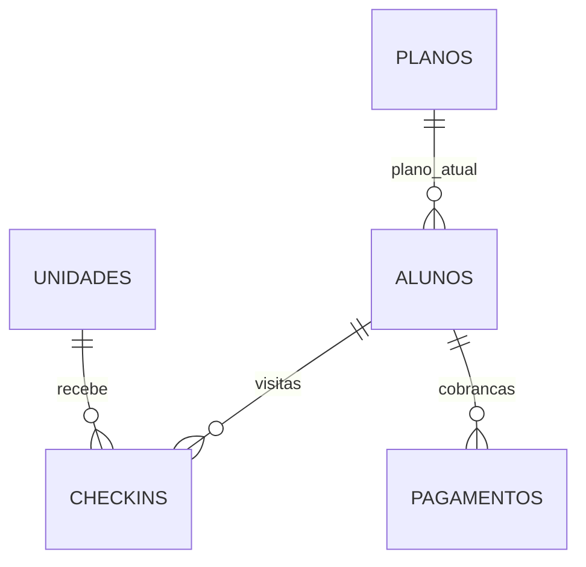

# Cenário e dados

O cenário é uma academia com planos, alunos, unidades, check-ins e pagamentos.
A origem externa é um banco Azure SQL Database dedicado com cinco tabelas no schema dbo.
O gerador dos trabalhos anteriores foi preservado e recebeu casos adicionais de qualidade.

| Tabela | Chave primária | Linhas na origem |
|---|---|---:|
| planos | id_plano | 4 |
| unidades | id_unidade | 4 |
| alunos | id_aluno | 303 |
| checkins | id_checkin | 7.686 |
| pagamentos | id_pagamento | 2.160 |

As tabelas possuem PK física. Campos de negócio são armazenados como texto na origem
de demonstração para preservar espaços, domínios inconsistentes e entradas inválidas.
Os relacionamentos são lógicos: não há FK física bloqueando os casos de órfãos
incluídos intencionalmente. Essas referências são verificadas na Silver.

## Casos adicionados

| Registro | Situação |
|---|---|
| aluno 301, João | espaços e capitalização inconsistentes, email em maiúsculas e ativo=sim; recuperável |
| aluno 302 | nome vazio e email inválido; rejeitado |
| aluno 303 | plano 999 inexistente; rejeitado |
| check-in 7685 | visita de João; válido |
| check-in 7686 | aluno 302 rejeitado; referência inválida na Silver |
| pagamento 2157 | cobrança paga de João com status/forma em minúsculas; recuperável |
| pagamento 2158 | valor negativo |
| pagamento 2159 | referência ao aluno 302 |
| pagamento 2160 | referência ao aluno 303 e status fora do domínio |

O campo valor_mensal de planos é herdado do trabalho 2. O gerador divide seu valor
pela duração para formar a cobrança mensal. As análises financeiras usam pagamentos.valor.
Não há histórico contratual; o plano associado ao aluno é o plano atual.

Todos os dados são fictícios. Os registros adicionais foram definidos para esta
implementação; não representam um arquivo de dados fornecido pelo professor.
