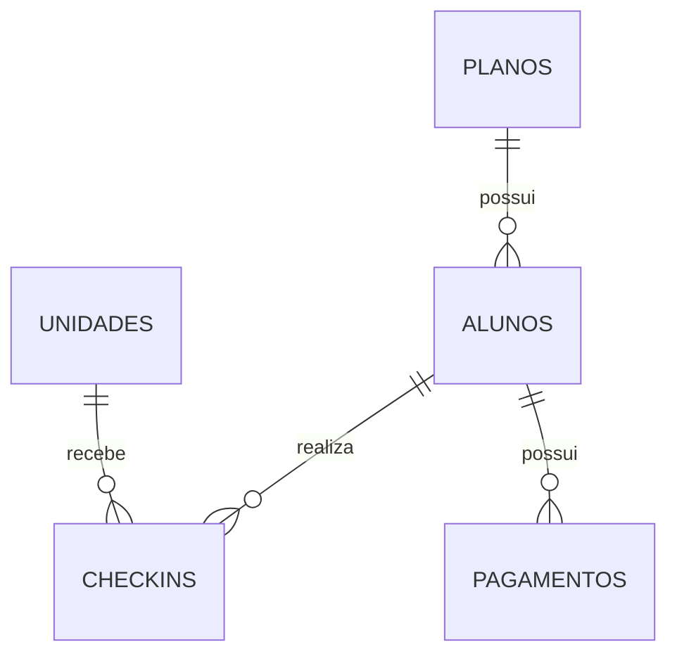

# Cenário e dados de origem

## Academia

O cenário representa uma academia com alunos vinculados a planos, unidades de
atendimento, registros de entrada e cobranças. Os dados são fictícios e foram gerados
com semente fixa pelo script herdado do trabalho 2.

## Entidades

| Tabela | Chave primária | Relacionamentos | Base original |
|---|---|---|---:|
| planos | id_plano | referenciada por alunos | 4 |
| unidades | id_unidade | referenciada por checkins | 4 |
| alunos | id_aluno | id_plano referencia planos | 300 |
| checkins | id_checkin | id_aluno e id_unidade referenciam seus cadastros | 7.684 |
| pagamentos | id_pagamento | id_aluno referencia alunos | 2.156 |

## Significado dos dados

**Planos:** nome, valor de referência e duração em meses. O nome valor_mensal é herdado
da origem; o gerador divide esse valor pela duração para definir a cobrança mensal.
A medida financeira utilizada nas análises vem de pagamentos.valor.

**Unidades:** nome, cidade, bairro e data de inauguração. Cada check-in aponta para
uma unidade, permitindo comparar a frequência de utilização.

**Alunos:** nome, email, cidade, plano atual, data de matrícula e situação de atividade.
Não existe histórico de mudanças de plano na origem.

**Check-ins:** eventos de visita, com aluno, unidade e data/hora. Cada ID identifica
um evento; várias visitas do mesmo aluno são eventos diferentes.

**Pagamentos:** cobrança identificada por aluno e competência, com valor, forma,
status e eventual data de pagamento. Os status previstos são PAGO, PENDENTE e ATRASADO.

## Snapshot e rastreabilidade

Os CSVs gerados localmente populam o banco relacional. O arquivo academia.db é o
snapshot utilizado pela extração. O manifesto de origem registra contagens e SHA-256
do arquivo, permitindo conferir se banco e manifesto correspondem.

A extração executada no Databricks consulta as tabelas do SQLite e produz novos CSVs
na Landing. Assim, a fonte do pipeline é o banco, e não apenas uma cópia dos CSVs de carga.

O escopo contém exatamente as cinco tabelas acadêmicas. Se a estrutura do banco
for alterada, a verificação de tabelas da extração sinaliza a diferença, pois as
transformações posteriores dependem desse contrato.

## Limites da base

Não há dados reais de clientes. O conjunto não contém histórico contratual e não
permite reconstruir o plano vigente em cada evento passado. Algumas datas herdadas
do gerador podem apresentar eventos anteriores à matrícula; a implementação não
afirma validar essa regra temporal.
