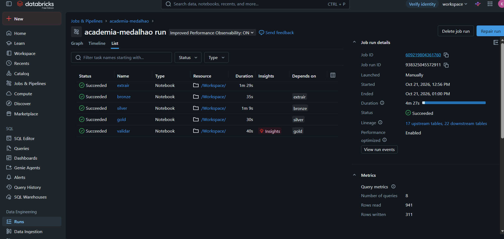
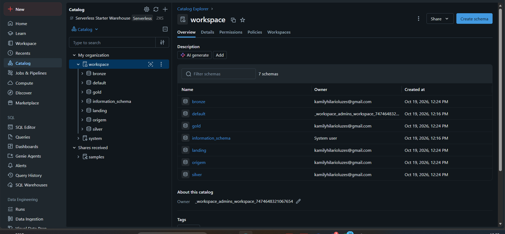
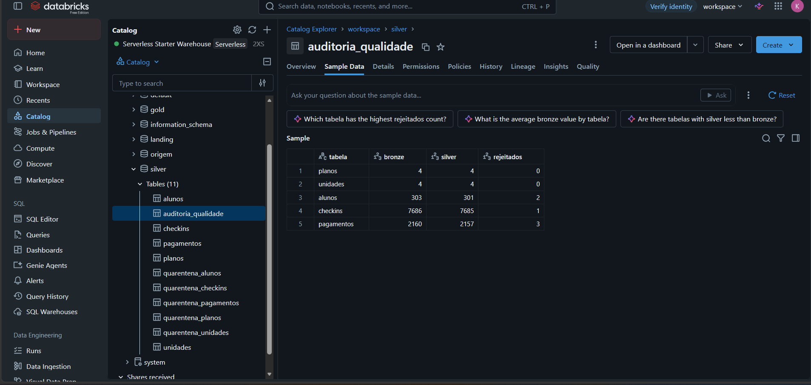
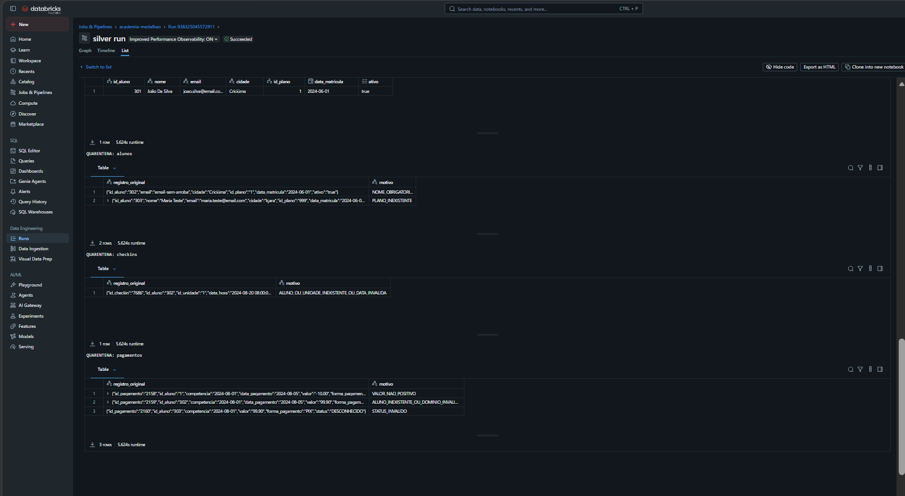
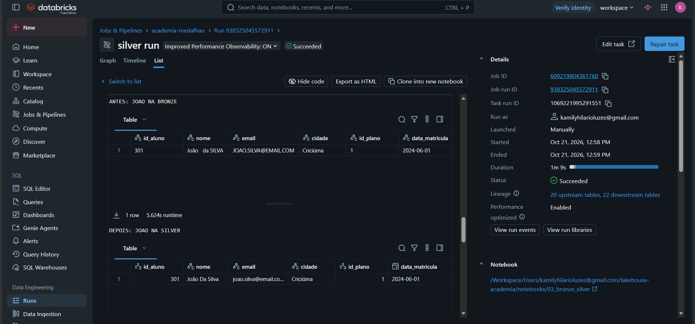
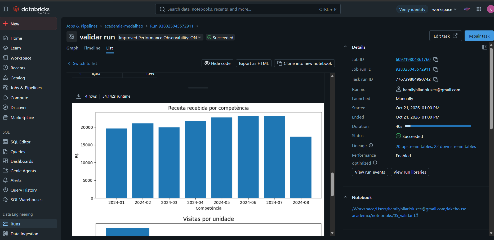
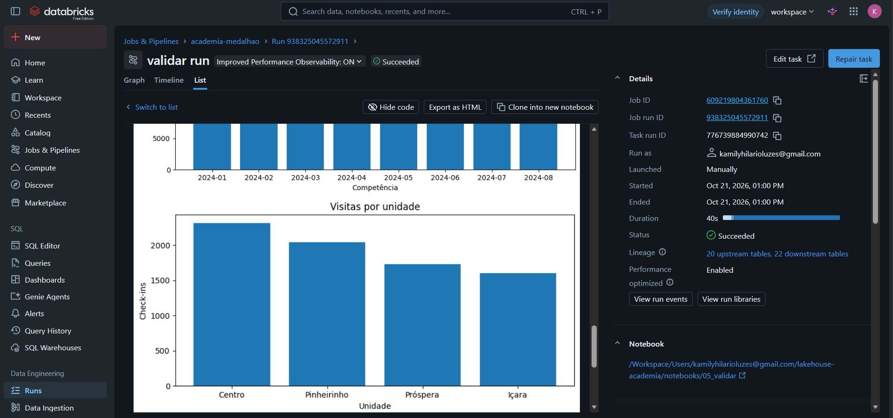

# Evidências da execução

Capturas reais fornecidas pelo grupo em 21/10/2026 durante a execução da versão
com origem no Azure SQL Database. As imagens originais foram preservadas.

## Job completo

As tarefas extrair, bronze, silver, gold e validar aparecem em Succeeded, com
dependências sequenciais.

| Identificação | Valor |
|---|---|
| Job | academia-medalhao |
| Job ID | 609219804361760 |
| Run ID | 938325045572911 |
| Duração exibida | 4min27s |

## Catálogo e schemas

O catálogo workspace contém os schemas landing, bronze, silver e gold utilizados
pelo pipeline. O schema origem também aparece por ser remanescente da versão anterior;
sua presença não significa que o Job Azure utilize o antigo SQLite.

## Auditoria da qualidade

O resultado de workspace.silver.auditoria_qualidade confirma a reconciliação
bronze = silver + rejeitados nas cinco tabelas.

| Tabela | Bronze | Silver | Rejeitados |
|---|---:|---:|---:|
| planos | 4 | 4 | 0 |
| unidades | 4 | 4 | 0 |
| alunos | 303 | 301 | 2 |
| checkins | 7.686 | 7.685 | 1 |
| pagamentos | 2.160 | 2.157 | 3 |

## Quarentenas

As seis rejeições correspondem aos casos intencionais da base. A captura mostra
os registros originais e os motivos; algumas células longas estão truncadas pela interface.

| Registro | Interpretação |
|---|---|
| aluno 302 | nome obrigatório ausente; o registro também tem email inválido |
| aluno 303 | plano inexistente |
| check-in 7686 | referência ao aluno 302, rejeitado na Silver |
| pagamento 2158 | valor não positivo |
| pagamento 2159 | referência ao aluno 302 |
| pagamento 2160 | status inválido e referência ao aluno 303 |

O motivo é uma classificação por registro, não uma lista de todas as regras violadas.
A rejeição de filhos ligados a alunos inválidos demonstra a validação referencial.

## Antes e depois de João

O aluno 301 permanece na Silver. O nome passa de João da SILVA para João Da Silva,
e os identificadores passam de texto para inteiro. O email da origem aparece em
maiúsculas; na Silver aparece em minúsculas, parcialmente truncado. A coluna ativo
ficou fora da área visível nesta captura, portanto não é apresentada como evidência visual.

## Receita recebida por competência

A saída do notebook 05 mostra a distribuição de valor_recebido entre janeiro e agosto
de 2024. Apenas registros PAGO compõem a receita recebida. O agrupamento é pela
competência da cobrança, e não pela data efetiva de pagamento.

O gráfico apresenta variações mensais, com junho e julho entre os maiores valores
e agosto com o menor valor no período exibido. A imagem não contém rótulos numéricos
de cada barra, por isso não é usada para atribuir valores exatos a cada mês.

## Visitas por unidade

O gráfico agrega quantidade da fato_checkin por unidade. Centro tem a maior frequência,
seguido de Pinheirinho, Próspera e Içara. A análise utiliza o grão de check-in, separado
do grão de pagamento, evitando multiplicação de receitas por visitas.

## Alcance das evidências

Os prints documentam uma execução real fornecida pelo grupo, incluindo o estado das
tarefas e as saídas de qualidade e análise. A reexecução da versão Azure e a execução
controlada do notebook 99_limpar ainda não foram confirmadas. O Job SQLite anterior
não é tratado como teste de reexecução desta versão.
