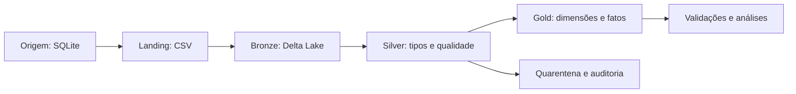
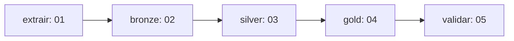

# Trabalho 3 - Lakehouse da academia

**Integrantes:** Kamily Hilário das Luzes · Kauã Lucas Alves Barbosa

Implementação acadêmica para Ubuntu no WSL2 e Databricks Free Edition. Entrega indicada no enunciado: 21/10. Este material foi preparado em 19/10/2026.

## Objetivo e rastreabilidade

| Requisito do PDF | Implementação | Evidência a coletar |
| --- | --- | --- |
| Extrair todas as tabelas do banco | SQLite com planos, unidades, alunos, checkins e pagamentos; notebook 01 consulta sqlite_master e extrai todas | Manifesto e cinco CSVs |
| Schema Landing/dados em CSV | Schema landing com volume dados | Catalog Explorer e CSV aberto |
| Bronze em Delta | Notebook 02, cinco tabelas Delta | DESCRIBE DETAIL e contagens |
| Data Quality na Silver | Notebook 03, tipos, domínios, PK, FK e quarentena | auditoria_qualidade e rejeições |
| Modelo dimensional Kimball | Notebook 04, quatro dimensões e duas fatos | Modelo e consultas |
| Execução sequencial em Job | 01 -> 02 -> 03 -> 04 -> 05 | Execução Succeeded com cinco tarefas |
| Novo GitHub, README e MkDocs | Pasta independente com configuração e documentação | URL do novo repositório e site |

O material de aula citado no PDF não foi fornecido; o código aqui foi desenvolvido com base nos dois repositórios indicados e na documentação oficial. O banco escolhido é SQLite, permitido pelo enunciado, com as mesmas cinco tabelas e gerador do trabalho 2. Não se afirma que a extração parte do SQL Server. Os CSVs gerados inicialmente servem para popular a origem; no Job, novos CSVs são extraídos do banco SQLite real.

## Arquitetura

O Ubuntu prepara a origem com o gerador do trabalho 2. Os CSVs populam o SQLite; um snapshot do banco e seu manifesto são enviados ao volume origem.arquivos.

## Orquestração

Todas as tarefas usam compute Serverless e o mesmo parâmetro catalogo.
Cada tarefa prossegue após sucesso da anterior. O notebook 00 prepara o ambiente antes do Job.

Landing/dados é interpretado como schema landing e volume dados. Um schema registra objetos; um volume armazena arquivos CSV. Caminho: /Volumes/CATALOGO/landing/dados. Não se cria uma tabela Delta na Landing para fingir que ela é CSV.

## Estado da entrega

Os testes locais da origem e sintaxe passaram. Durante a execução guiada, o grupo confirmou upload, execução dos notebooks, zero rejeições na Silver e sucesso do Job completo. Uma captura mostrou as cinco tarefas em sucesso; a reexecução também foi confirmada pelo estudante. A publicação do novo repositório e do site deve ser conferida após executar os comandos de Git e MkDocs. Testes locais, execução remota e publicação são verificações distintas.
