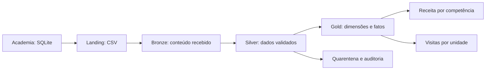

# Lakehouse da Academia

**Trabalho 3 - Engenharia de Dados (SATC)**  
**Integrantes:** Kamily Hilário das Luzes · Kauã Lucas Alves Barbosa

## Objetivo

Transformar dados operacionais de uma academia em uma base analítica no Databricks,
com organização em camadas, regras de qualidade, modelo dimensional e execução
sequencial dos notebooks por um Job.

A solução responde a duas questões analíticas: **como os recebimentos se distribuem
por competência** e **como as visitas se distribuem entre as unidades**.

## Escopo

O projeto processa cinco tabelas de um banco SQLite: planos, unidades, alunos,
checkins e pagamentos. Todas são extraídas para CSV e percorrem as camadas
Landing, Bronze e Silver. A Gold reúne quatro dimensões e duas tabelas fato.

| Camada | Papel na solução | Saída |
|---|---|---|
| Landing | preservar a extração do banco | cinco arquivos CSV e manifesto |
| Bronze | registrar os dados recebidos em tabelas transacionais | cinco tabelas Delta |
| Silver | converter tipos e aplicar regras de qualidade | cinco tabelas válidas, quarentenas e auditoria |
| Gold | organizar os eventos para análise | quatro dimensões e duas fatos |

## Arquitetura

As camadas separam responsabilidades. A extração permanece disponível para comparação;
a Bronze conserva o conteúdo recebido; a Silver registra quais dados passaram nas regras;
a Gold estabelece o grão e as relações usadas nas análises.

## Continuidade dos trabalhos anteriores

O trabalho 1 explorou Spark, Delta Lake e Iceberg. O trabalho 2 acrescentou extração
de SQL Server, armazenamento CSV no MinIO e tabelas Delta. O trabalho 3 reutiliza o
cenário e o gerador de dados do trabalho 2, com SQLite como origem escolhida, e acrescenta
processamento gerenciado, qualidade, modelagem dimensional e orquestração.

## Organização desta documentação

- [Cenário e dados](dados.md): entidades, relacionamentos e características da base.
- [Pipeline e orquestração](pipeline.md): o que cada notebook faz e como as etapas se relacionam.
- [Qualidade dos dados](qualidade.md): conversões, regras, quarentena e auditoria.
- [Modelo dimensional](modelagem.md): dimensões, fatos, grãos e medidas.
- [Validações e resultados](testes.md): critérios de consistência, resultados registrados e análises.
- [Referências](referencias.md): fontes e créditos do projeto.

As tecnologias, os requisitos e as instruções de instalação e execução estão no
[README do repositório](https://github.com/02kamk/lakehouse-databricks-medalhao#readme).
