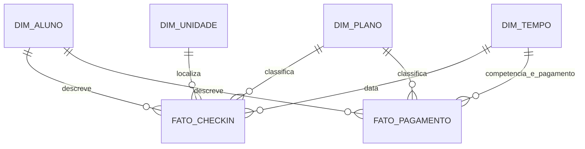

# Modelo dimensional

## Objetivo e grão

A Gold utiliza modelagem dimensional para analisar frequência e recebimentos.
O grão representa o evento descrito por cada linha. Visitas e pagamentos possuem
grãos distintos e são mantidos em duas tabelas fato.

| Tabela | Grão | Conteúdo |
|---|---|---|
| dim_aluno | um aluno | identificação, cidade, atividade e plano atual |
| dim_plano | um plano | nome, valor de referência e duração |
| dim_unidade | uma unidade | nome, cidade, bairro e inauguração |
| dim_tempo | um dia | data, ano, mês, dia e trimestre |
| fato_checkin | um check-in | aluno, plano atual, unidade, data/hora e quantidade |
| fato_pagamento | um pagamento | aluno, plano atual, competência, data de pagamento, valor, status e forma |

## Dimensões compartilhadas

Aluno, plano e tempo são compartilhados entre as fatos. Unidade participa apenas
da análise de check-ins, pois a origem não atribui unidade a cada pagamento.

## Calendário e papéis de data

dim_tempo possui um calendário contínuo entre a menor e a maior data dos eventos
considerados. Sua chave é YYYYMMDD. Na fato_pagamento, a dimensão exerce dois papéis:
sk_competencia identifica a competência e sk_pagamento identifica a data do recebimento.
sk_pagamento pode ser nulo em cobranças ainda não pagas.

## Medidas

- **quantidade:** valor 1 por check-in; sua soma representa o total de visitas.
- **valor:** montante de cada cobrança, independentemente do status.
- **valor_recebido:** igual ao valor quando o status é PAGO e zero nos demais casos.

A consulta financeira agrupa valor_recebido por competência. Portanto, descreve os
recebimentos associados ao mês da cobrança, sem representar fluxo de caixa agrupado
pelo dia efetivo de recebimento.

## Chaves e histórico

sk_aluno, sk_plano e sk_unidade são chaves técnicas long derivadas dos IDs da única
origem. Essa escolha mantém valores estáveis no laboratório, mas não constitui um
mapeamento de chaves independente para múltiplas fontes.

As dimensões são tipo 1, reconstruídas na carga completa. Não existe SCD2, e o plano
relacionado aos fatos corresponde ao cadastro atual do aluno. A origem não permite
afirmar qual plano estava vigente em cada evento histórico.

Os identificadores dos eventos são preservados nas fatos como dimensões degeneradas,
permitindo rastrear a linha analítica até o evento de origem.

## Agregação entre fatos

Uma junção direta das duas fatos por aluno pode multiplicar pagamentos pelo número
de visitas. Análises conjuntas exigem agregações separadas em um grão compatível antes
de combinar os resultados. As consultas disponibilizadas utilizam cada fato separadamente.
