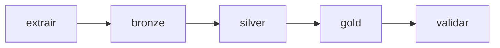

# Pipeline e orquestração

## Preparação da origem

O gerador produz a base acadêmica, e o script de preparação cria as cinco tabelas
SQLite, verifica as referências e registra o manifesto. O snapshot é disponibilizado
no volume origem.arquivos. Essa preparação é anterior ao Job.

## Etapas implementadas

| Notebook | Responsabilidade | Resultado |
|---|---|---|
| 00_configurar | preparação dos objetos de armazenamento | schemas e volumes necessários |
| 01_extrair_landing | conferir snapshot e extrair todas as tabelas do escopo | CSVs e manifesto na Landing |
| 02_landing_bronze | preservar conteúdo textual e registrar ingestão | cinco tabelas Delta Bronze |
| 03_bronze_silver | converter tipos, aplicar regras e separar rejeições | Silver, quarentenas e auditoria |
| 04_silver_gold | relacionar cadastros, datas e eventos | dimensões e fatos |
| 05_validar | reconciliar dados e produzir consultas analíticas | verificações e resultados |

## Landing

O schema landing contém o volume dados, utilizado para arquivos CSV. A organização
separa arquivos de extração de tabelas analíticas registradas no catálogo. O manifesto
da Landing contém as contagens extraídas e a identificação do snapshot.

## Bronze

As cinco tabelas são gravadas em Delta Lake. As colunas recebidas permanecem textuais,
preservando os valores da origem antes de conversões. A coluna _ingestao registra o
momento da carga. As contagens são comparadas com o manifesto.

## Silver e Gold

A Silver aplica as [regras de qualidade](qualidade.md). Os pais são processados antes
dos filhos para que as referências sejam verificadas contra registros já válidos.
A Gold lê os dados válidos e forma o [modelo dimensional](modelagem.md).

## Job sequencial

Cada tarefa depende do sucesso da anterior. O notebook 00 é preparação inicial e
não faz parte dessa cadeia. O Job possui uma execução simultânea, e todas as tarefas
utilizam o mesmo catálogo, mantendo as camadas no mesmo contexto.

## Carga e consistência

A estratégia é carga completa por snapshot. As tabelas são substituídas a cada carga;
não há CDC nem processamento incremental. Sobre uma origem estável, os totais de
eventos e os valores analíticos devem se conservar entre execuções. Timestamps de
ingestão e versões Delta podem mudar.

As transações Delta protegem cada escrita de tabela. Não existe uma transação única
para todo o Job: falhas podem deixar camadas parcialmente atualizadas. A cadeia de
dependências evita que uma tarefa posterior avance após falha da anterior.
