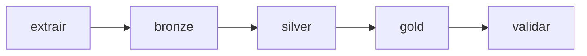

# Pipeline e orquestração

## Origem externa

O banco no Azure mantém as cinco tabelas mesmo após limpar as saídas do Databricks.
A extração consulta o inventário de tabelas do banco e confere o contrato das cinco
tabelas dbo. Não existem cópias SQLite utilizadas pelo novo Job.

## Responsabilidades

| Notebook | Função |
|---|---|
| 00_configurar | preparação dos schemas e do volume Landing |
| 01_extrair_landing | conexão ao Azure SQL e extração completa para CSV |
| 02_landing_bronze | leitura da extração e gravação Delta, preservando conteúdo textual |
| 03_bronze_silver | tipos, normalização, regras, quarentena e auditoria |
| 04_silver_gold | construção das quatro dimensões e duas fatos |
| 05_validar | reconciliação, conferência das rejeições previstas e gráficos |
| 99_limpar | remoção controlada apenas das saídas acadêmicas do Databricks |

## Job

As cinco tarefas dependem do sucesso da anterior. A preparação 00 e a limpeza 99
ficam fora do Job. A concorrência é 1, para evitar colisão entre cargas completas.

O notebook 01 usa o conector SQLSERVER nativo do Databricks, com parâmetros jdbc_host,
jdbc_database, jdbc_user e jdbc_password. O tráfego é cifrado e o certificado do
servidor é validado. Não há uso de Maven ou acesso direto à JVM nos notebooks.

A extração é materializada no volume antes das transformações. Um manifesto registra
contagens e instante de extração. Durante o ensaio, a origem deve permanecer estável:
não existe uma transação distribuída cobrindo todas as leituras e escritas.

## Limpeza e reconstrução

99_limpar utiliza uma lista explícita de tabelas e caminhos do projeto. Não executa
DROP DATABASE, não apaga o catálogo, não apaga schemas e não acessa o Azure SQL.
O widget confirmar exige SIM. O Job seguinte reconstrói as camadas a partir do banco externo.
